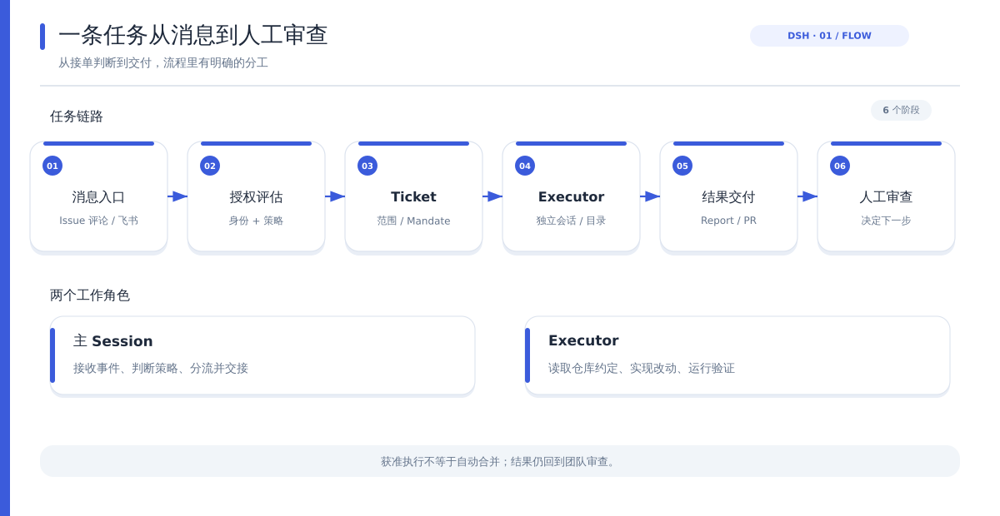
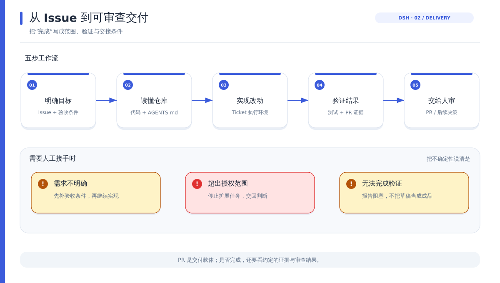
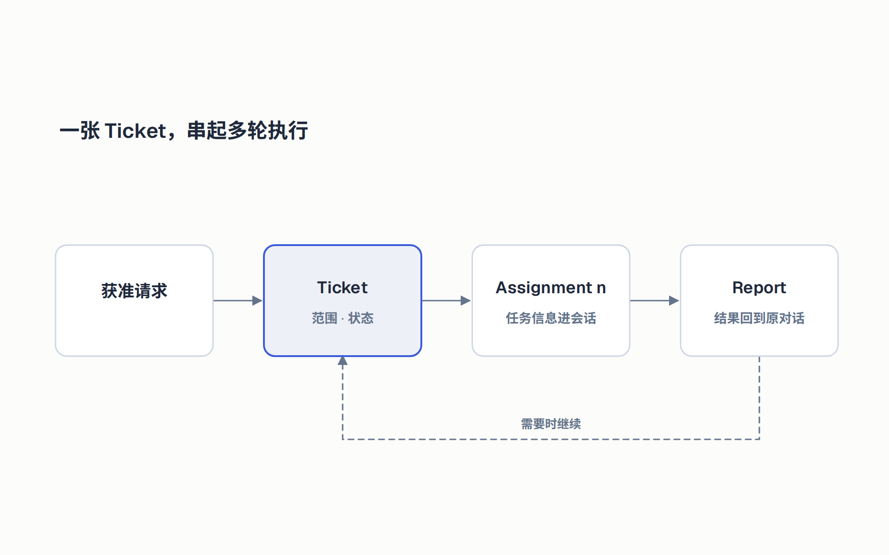
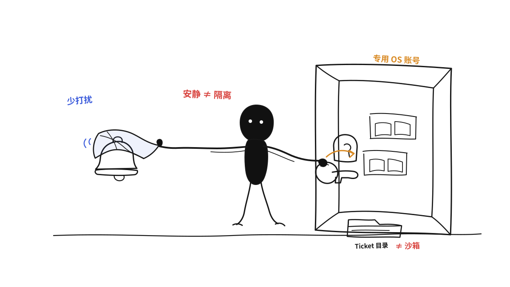

# Superagent 的自主边界：少打扰人，如何不靠长对话完成长任务

DeepSeek 公开的 dsh-superagent-prototype 面向一个 GitHub 仓库。获准的用户可以在 Issue 评论中向它提出任务；系统判断后创建工作项，由 Executor 在独立会话和工作目录中处理，再回到原对话反馈结果，例如提交 Pull Request。

这条链路看起来像“@机器人修 Issue”。文章聚焦三件事：谁能派活，一个任务如何接着做，什么时候该叫人回来。README 将它定位为研究原型，提醒用户不要直接用于生产。[项目说明](https://github.com/deepseek-ai/dsh-superagent-prototype)

## 用途定位

dsh-superagent 是围绕代码仓库工作的主动式编程 Agent。它监听 GitHub，也可以选配飞书；收到符合规则的请求后，把任务交给执行会话，最后把结果带回原来的协作渠道。它面向单个 GitHub 仓库，重点是团队的 Issue 和 PR 工作流。

一次任务大致经过“消息进入 → 权限判断 → 建立 Ticket → 执行 → 返回结果”。Ticket 像一张持续存在的工作单，记录任务内容、授权范围和执行状态。Executor 是负责读代码、修改和验证的工作会话。

公开仓库与团队内部版本有所不同，相关论文中的部分方向也尚未实现。下文只讨论当前仓库已经公开的能力。[README](https://github.com/deepseek-ai/dsh-superagent-prototype)

## 任务入口

部署时，文档建议把 Superagent 放进独立的 DeepSeek Harness profile，并给它单独的 GitHub 账号；再配置目标仓库、允许发起任务的人、模型和执行目录。飞书可以作为额外消息入口，但不是必选项。[设置指南](https://github.com/deepseek-ai/dsh-superagent-prototype/blob/main/SETUP.md)

对使用者来说，流程可以概括成四步：

1. 在 GitHub Issue 的评论中提及 Agent，并说明要处理的任务。
2. 系统根据来源、发起者和规则判断是否接单。
3. 获准后，Agent 开始处理；使用者可以在 Superagent 面板查看任务状态。
4. Executor 将结果发回原对话，使用者检查改动和 PR，再决定后续处理。

权限判断不只看消息里写了什么。文档把来源身份、允许名单和策略规则作为授权依据；评论正文、引用文档等内容是任务输入，不能自行扩大权限。[授权模型](https://github.com/deepseek-ai/dsh-superagent-prototype/blob/main/docs/002-authorization.md)

对于团队规则触发的主动工作，部署建议从 `observe` 模式起步：先观察 Agent 会提出什么动作，再决定是否允许它执行。团队可以据此校准规则，再开放主动执行。

## 修复闭环

Superagent 把修 Issue 的步骤分开：限定范围、读取仓库、实现、验证、交付。公开文档描述了这套流程和交付边界，没有展示一套能自动保证修复质量的通用算法。

主 Session 接收、判断和分流。Executor 结合原始请求和仓库约定来判断任务范围、实现改动并做验证。团队还可以配置自己的提示词和 skills，把项目特有的构建、测试、代码风格和交付要求交代给它。[提示词与团队配置](https://github.com/deepseek-ai/dsh-superagent-prototype/blob/main/docs/004-prompts.md)

这套闭环可以拆成五个动作：

- **定范围：**明确要解决的问题、预期结果，以及哪些改动不在本次任务内。
- **看仓库：**结合 Issue、现有代码和仓库内的 `AGENTS.md` 等规则理解项目，先查清项目约定再决定实现方式。
- **做改动：**在该 Ticket 对应的执行环境中修改代码。
- **做验证：**按仓库约定运行测试或检查，并准备 PR 所需的证据。
- **交给人审：**提交可审查结果；需要设计判断、遇到阻塞或超出范围时，把问题交还给人。

`Ticket scope` 约定工作做到什么程度、何时停下；`Delivery requirements` 可以约定 PR 证据和提交身份。团队能把“何时停”和“交付什么”写进规则：**开出 PR 不自动等于任务完成，草稿要标明未完成。**目标含糊时，可以先问一个具体问题，或把未完成的改动交给人继续判断。提示词无法替团队补足缺失的产品需求。[提示词与交付规则](https://github.com/deepseek-ai/dsh-superagent-prototype/blob/main/docs/004-prompts.md)

这对功能开发尤其重要。团队可以用复现条件和测试结果界定 Bug 修复；功能请求还需要写清验收条件和影响范围。Superagent 提供了配置任务边界的入口，公开文档没有规定通用的功能拆解方法，也没有承诺每项改动都运行同一组测试。完成质量仍取决于仓库规范、测试和团队配置。

## 长任务状态

Superagent 的任务链路可以简化为：`Source → Trigger → Eval → Ticket / Mandate → Assignment → Executor → Report`。消息先成为 Trigger，Eval 再检查是否符合策略。通过后，系统建立带范围的 Ticket / Mandate，并交给 Executor 执行。[领域模型](https://github.com/deepseek-ai/dsh-superagent-prototype/blob/main/docs/001-domain.md)

Ticket 记录任务范围和状态，Assignment 记录每轮执行，Report 带回结果。需要补充信息或人工处理时，Ticket 可以等待后续输入；文档也说明程序启动时会恢复中断的 Assignment。每个 Ticket 对应一个 Executor Session 和工作目录。[执行模型](https://github.com/deepseek-ai/dsh-superagent-prototype/blob/main/docs/003-execution.md) · [实现架构](https://github.com/deepseek-ai/dsh-superagent-prototype/blob/main/docs/007-architecture.md)

Ticket 和 Assignment 没有替代模型上下文，Executor 仍要拿到任务信息才能继续工作。它们把授权、进度、输入和交付状态留在可追踪的任务对象里，让长期任务不只依赖模型记住前面的对话。

从使用者角度看，长任务不再只有“正在运行”一种状态：它可能正在工作、等待新触发、等待人答复、已经准备好审核，或者遇到阻塞。面板按工作流展示 Ticket、授权、等待输入和 Assignment 历史，帮助人找到真正需要自己处理的部分。[面板说明](https://github.com/deepseek-ai/dsh-superagent-prototype/blob/main/docs/005-panel.md)

## 自主边界

项目倡导低噪声通知：接单后保持安静，有结果、需要决策或无法继续时再回到原对话反馈。面板先显示需要人处理的任务，再展示系统健康和历史记录。[设计原则](https://github.com/deepseek-ai/dsh-superagent-prototype/blob/main/docs/000-philosophy.md) · [面板说明](https://github.com/deepseek-ai/dsh-superagent-prototype/blob/main/docs/005-panel.md)

部署安全需要单独评估。文档指出，Router 和 Worker 的预设以操作者的操作系统用户身份运行，并使用 `danger-full-access`；GitHub 凭据包装器只负责选择账号，不会隔离进程。每个 Ticket 有自己的工作目录，也不能直接等同于操作系统级沙箱。文档建议需要隔离时，使用只存放 Agent 凭据的专用 OS 账号。[部署与隔离说明](https://github.com/deepseek-ai/dsh-superagent-prototype/blob/main/docs/006-deployment.md)

人仍要判断任务目标、验收结果和权限。Superagent 减少的是盯进度的频率；部署者仍需控制执行进程能访问什么。

试用时先选一个仓库，限定可发起任务的人员，把验收条件和测试命令写进仓库说明。看它能否按边界交付，再考虑扩大范围。运行账号和访问权限也要单独评估，不能与通知规则混为一谈。

### 参考资料

- [dsh-superagent README](https://github.com/deepseek-ai/dsh-superagent-prototype)
- [SETUP 设置指南](https://github.com/deepseek-ai/dsh-superagent-prototype/blob/main/SETUP.md)
- [领域模型](https://github.com/deepseek-ai/dsh-superagent-prototype/blob/main/docs/001-domain.md) 与 [授权模型](https://github.com/deepseek-ai/dsh-superagent-prototype/blob/main/docs/002-authorization.md)
- [执行模型](https://github.com/deepseek-ai/dsh-superagent-prototype/blob/main/docs/003-execution.md)、[提示词](https://github.com/deepseek-ai/dsh-superagent-prototype/blob/main/docs/004-prompts.md) 与 [面板](https://github.com/deepseek-ai/dsh-superagent-prototype/blob/main/docs/005-panel.md)
- [部署指南](https://github.com/deepseek-ai/dsh-superagent-prototype/blob/main/docs/006-deployment.md) 与 [实现架构](https://github.com/deepseek-ai/dsh-superagent-prototype/blob/main/docs/007-architecture.md)
