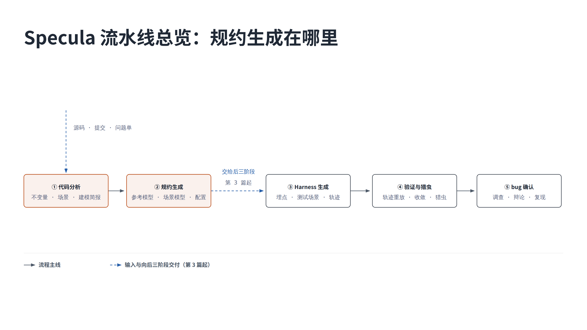
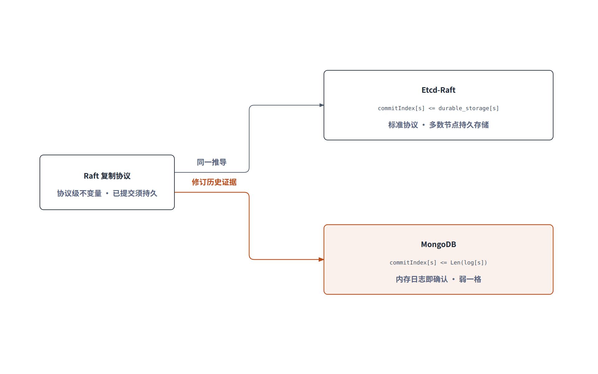
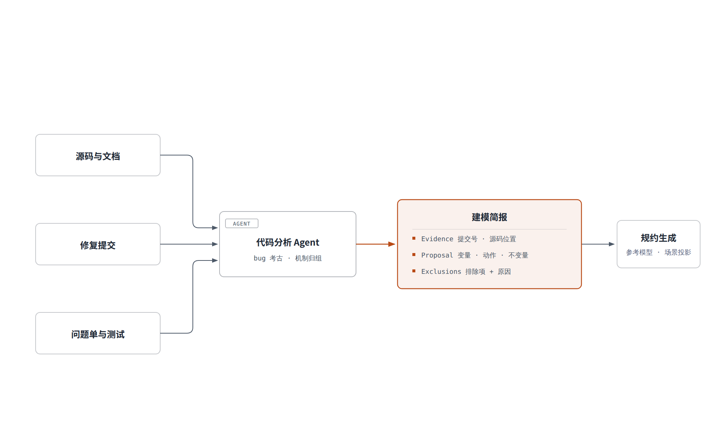
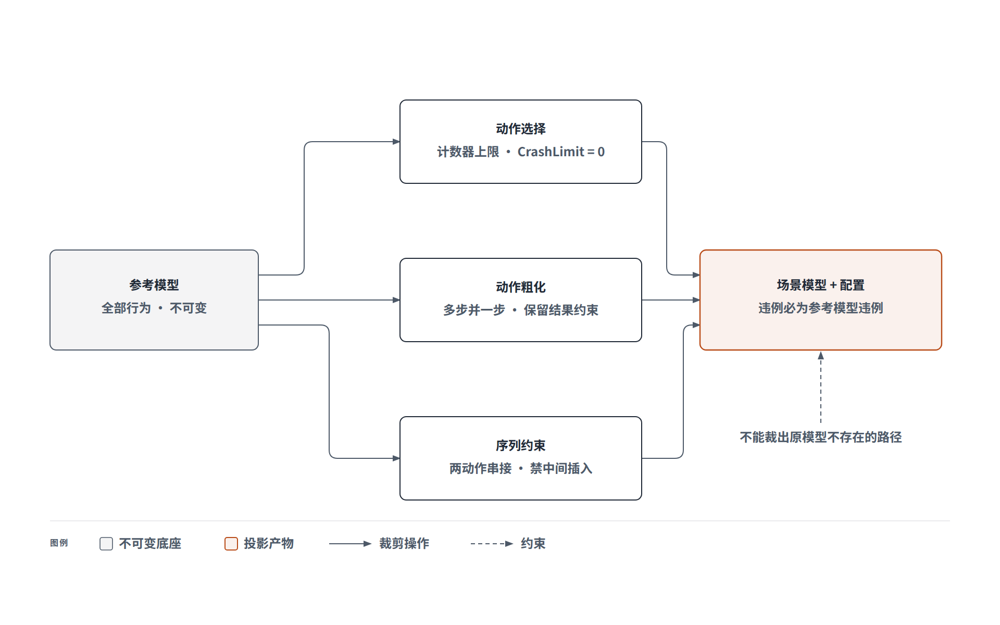

先看两条真实的不变量。Etcd-Raft 要求已提交记录进入多数节点的持久存储；MongoDB 只要求进入内存日志。同源 Raft，检查条件只差一个变量，给出的保证差一档，而且各自都对。生成一条能做出这种级别判断的流水线，就是本篇要拆的东西。



## 先看整机在哪里

Specula 处理一个并发或分布式系统，走五个阶段。第一篇画过全程地图，本篇只进前两个阶段：代码分析和规约生成。

直接让 Agent 读源码写模型是行不通的，细节留多了状态爆炸，砍狠了照不出真实偏差，论文把这称为模型与代码之间的鸿沟。Specula 的替代方案如上图：一条产物接力线，不变量、场景、建模简报、参考模型、场景模型加配置，每个产物有固定格式和证据要求。Agent 在线上工作，不自由发挥。

## 对错标准从两头取证

不变量是 TLC 判定对错的标准，接力线第一个产物。协议说明与文档给协议级条件；源码、测试、问题单和修订历史给代码级条件，覆盖操作原子性、容量上限、提交位置单调性这类模式。分析只总结系统级行为，API 参数、变量类型这类局部检查不进模型。



开头那对不变量是这样来的。Etcd-Raft 遵循标准协议，条件写作持久存储：

```
CommittedInDurableStorage ==
  \A s \in Server :
    commitIndex[s] <= durable_storage[s]
```

MongoDB 为降低写延迟，配置允许多数节点保存在内存中即确认提交，不等落盘。设计用持久性换了写延迟，换来另一条保证：节点不会确认一条还没写进自己日志的记录。Specula 从修订历史找到那次变更，换成弱一格的条件。

```
CommittedInLog ==
  \A s \in Server :
    commitIndex[s] <= Len(log[s])
```

套错条件，模型会把设计允许的行为报成错误，检查白跑。所以每条不变量强制附带证据：代码位置、提交号、问题单或测试断言。Agent 后续修改检查条件时必须回到证据说明理由，不能拿检查通过当放宽依据。

不变量还要声明故障模型：允许进程崩溃还是断电。同一条不变量在两种故障模型下，结论强度不同。

系统按并发模型分两类，分析路径随之分叉。消息协调的分布式系统关注请求、确认与落盘的顺序；共享内存的并发系统关注读取与更新之间其他线程能否插入，以及内存回收、所有权转移、唤醒路径。变量设计也随类型分叉，前者围绕协议状态，后者围绕线程本地快照、回收状态、交接标记、缓存视图。

## 代码考古圈定执行路径

不变量定了检查什么，场景决定往模型里放哪些执行路径。来源是代码考古，工程指南对深度有量化要求。

Git 历史按关键词挖掘，修复、竞态、死锁、崩溃、损坏、泄漏、不一致，触碰核心文件的缺陷修复提交要全部分析，不许抽样。问题单要读完整讨论串，中等规模项目目标精读三十个以上，并统计口径：收集多少、精读多少、确证多少、误报排除多少。

假线索靠上下文排除。标题声称缺陷、讨论里确认是配置错误的，记录排除；看似漏了判空的代码，顺执行链找到上游早已挡住输入的，也记录排除。

立住一个场景要凑齐三个条件：

- 机制上，有多处修复或修复互不一致的痕迹
- 代码上，能指出具体的路径分歧
- 后果上，能讲出到可观测故障的因果链

缺一样，降级为待查疑点。

场景按机制归组，不按文件归组，五个可执行的机制场景胜过十七条平铺的发现。

论文中的场景条目来自 ScyllaDB 的 Raft 实现，三个触发信号：

- 同一机制被三个提交反复修复，围绕联合配置时期的投票者跟踪
- 两处代码处理不一致：发送读确认请求的路径（fsm.cc:1052）用缓存的投票标记决定发给谁，判定确认是否足够的路径（tracker.cc:178）同时查看新旧两套名单
- 组合成一条因果链：成员降级时节点在旧名单有投票权、新名单没有，缓存只反映新身份，请求漏发旧名单仍计入的节点，读请求可能停滞

这个问题问请求最终能否完成，属于活性，不是丢数据那样的安全违例。场景条目据此列出建模建议：

- 变量：config、voters、canVote
- 动作：EnterJoint、ReadBarrier
- 不变量：ReadBarrierProgress已修复的问题作背景保留，重新复现旧缺陷不算新发现。

## 建模简报是唯一交接物



场景和证据打包成建模简报，交给规约生成 Agent。它是两个阶段之间唯一的交接物，格式固定：证据、变量、动作、不变量，外加排除项，对应上图三块。论文给出 ScyllaDB 那条场景的简报原文：

```
Scenario. Joint consensus quorum tracking on voter demotion
Evidence:
  history: Three fixes reworked joint-config voter tracking
  code:    broadcast_read_quorum (fsm.cc:1052) sends a read
           quorum to followers whose cached vote flag is set
           committed<read_id> (tracker.cc:178) commits a read
           on acks from both current and previous voter sets
Modeling proposal:
  variables: config[s], voters[s][c], canVote[s]
  actions:   EnterJoint, LeaveJoint, ReadBarrier, ...
  invariant: ReadBarrierProgress -- an issued read barrier
             eventually commits
```

简报还做两件事。

- 分流：每个发现标注验证方式，需要探索多节点、多线程交错顺序的进模型检查，日志格式或性能问题交给测试和代码审查，暂时答不了的列为未决问题
- 划界：每项排除附原因，规约生成阶段不得自行扩回简报是后续覆盖核对的唯一基准，简报没提的不进检查范围。

规约生成 Agent 只精读简报引用的函数，不重读整个代码库。简报说两条路径用了不同的身份信息，Agent 要核对各自何时更新、用哪个字段。只有这些差别进入模型，TLC 才有机会走到出错的路径。

每条发现进简报前都要过核实关：回读确切代码行，找补偿机制，确认它不是写明的设计决定。未经核实的怀疑不许写进简报。

## 建模实现，不建模论文

参考模型是所有场景共享的底座。保什么砍什么，由不变量决定。Papaya 是并发哈希表，要检查条目不丢失，模型保留每个槽位的元数据和条目指针，两者不一致就是丢失；哈希函数不进模型，因为没有不变量依赖它的计算结果。

总原则一条：建模实现，不建模论文。实现与参考算法的偏差正是 bug 藏身之处，MongoDB 那条弱一格的不变量就是偏差的直接产物。Agent 觉得代码怪而顺手改回论文写法的那一刻，模型就照不出这个系统的真问题了。

动作设计有三条硬规则：

- 按实现的语义边界拆分。模型里的动作是原子的，其他动作插不进中间，源码里先读状态、再确认、后更新的三步合并成一步，就抹掉了竞态可能藏身的窗口。预留与发布、停用与释放，源码分开，模型也分开
- 动作以实现函数命名，方便模型与代码逐块对照
- 每个逻辑块的守卫、分支和更新标注源码行号，后续轨迹核对要靠行号定位

模型骨架三块：

- 状态变量，承接实现字段和数据结构
- Init，描述系统起动时的合法取值
- Next，列出所有动作，规定每一步之后变量如何变化

结构不变量始终启用，检查变量取值是否合法，不找 bug，只保证模型没写坏。

对称性约减让 TLC 把镜像状态当作一个，省下等价搜索量。规模控制反向操作：沉默动作不加约束会状态爆炸，要收到最小；扩展变量必须有场景支撑，简报里没有的不许加。

## 从底座裁出小模型



参考模型包含全部行为，每次都搜全部组合成本过高。场景投影从它裁出针对单个场景的小模型，参考模型本身不动，如上图三种操作。以 Etcd-Raft 租约读场景为例，旧主节点误判租约仍有效，继续响应读取，返回过期数据。

动作选择靠计数器限制次数，写在配置里：

```
CrashLimit = 0        \* 崩溃被禁用
ReadRequestLimit = 2  \* 保留两次租约读
```

动作粗化把多步过程换成一步。场景需要合法主节点但不检查选举，请求投票、等待、重选换成一步直接产生当选者，保留候选节点日志不落后于多数的约束，中间状态删掉。序列约束把两个相邻动作串成一次原子转换，保留两者逻辑，不再允许其他动作插入。

前一种是配置，后两种改变动作语义，不能混同。

裁剪有一条底线：小模型找到的违例必须也是参考模型的违例，不能裁出原模型不存在的错误路径。裁多少取决于目标。查租约读可以裁掉选举，查选举与成员变更的交互，中间状态就必须保留；缺陷若依赖处理与发送之间的插入，串接两步就藏掉了触发窗口。

故障包装层同样依目标而定。指南反对从别的案例复制包装器的名字和形状，每个包装器要从目标自己的代码证据推导，说不清要回答什么具体问题就不写。

指南举过反例：某个旧规约把一个已撤销的历史提交建了模，等于用规约重放一次合入又回退的变更，跑不出新信息。并发系统的尺度也要压：线程两到三个，缓冲区和键集取最小，无关动作上限收到零或一，目标交错路径才可达。

## 定义了不等于检查了

先看一次真实事故。Agent 定义了场景不变量，先在标准配置里注释掉，打算稍后放进专用配置，最后没做。TLC 跑了很久，实际只检查变量类型这类结构条件，要找的错误一次都没查。指南把这称为最后一环的脱扣，算力一分不少，产出为零。

事故的根源是没分清两类配置。模型定义了检查条件，TLC 不一定检查它，每次运行检查什么由配置决定。产出分两类：

- 标准配置，在收敛阶段用，查结构条件和基础安全性质，场景不变量先注释掉
- 逐场景配置，每个场景一份，只启用目标不变量加核心安全性质，无关动作边界收到零或一

配置的另一面是给事件设上限。崩溃、超时、消息丢失这类引入新分支的事件可以限次，计数器在同一个转换里先检查再递增，两步分开，上限形同虚设。处理已收到的消息、推进提交位置这类反应步骤不能限，否则模型会人为制造无法进展的假象。

基础模型的动作粒度在参考模型里定死，包装层不许悄悄合并或拆分动作来腾挪状态空间。

顺序也有讲究：先收敛，后猎虫。模型刚写完就用猎虫配置跑，未经核对的扩展不变量一起上线，错误的不变量报出假违例，反过来污染场景结论。

生成结束前做覆盖核对，以建模简报为唯一基准：

- 每条安全性质，是否至少在一个逐场景配置中启用，而不是只出现在定义文件里
- 每个场景，是否有对应的配置，合并进其他场景的要写明
- 每个待验证问题，其故障设置是否让它可达

缺口要么补上，要么写明为何不覆盖，不粉饰。

走完这条线，产物是一套模型加配置。每个环节都在防同一类错误：

- 不变量，靠证据锚住
- 场景，靠机制归组和量化深度
- 简报，靠固定格式防范围扩张
- 模型，靠语义边界防竞态窗口被抹掉
- 投影，靠 soundness 底线防假路径
- 配置，靠覆盖核对防性质定义了却没人查

语言本身不保证模型忠于代码，纪律才保证。

TLC 在这套产物上搜索。完整搜完给定范围且未发现违例，结论只适用于该模型与配置；因预算终止而未找到反例，不等于没有。模型反例是否对应真实 bug，要回到代码复现确认，那是第 4 篇的内容。

## 参考

- Qian Cheng 等：Specula: Scaling Formal Specifications for Autonomous Model Checking of System Code，arXiv:2607.25333v2（2026-08-03）
- Specula 项目：Code Analysis Workflow（bug 考古深度要求、发现分流与建模简报规范，main @ 830f4c0）
- Specula 项目：TLA+ Spec Generation Guide 与 MC Spec Pattern、Brief Coverage Checklist（main @ 830f4c0）
- Specula 项目：ScyllaDB Raft 案例分析与运行记录（case-studies @ 6266eb05）
