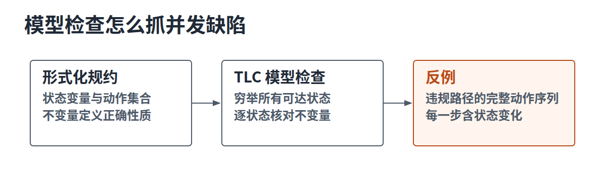
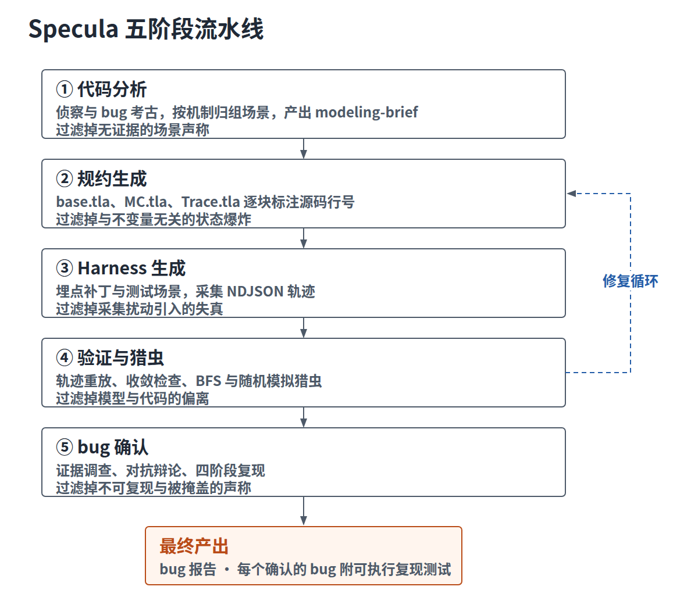
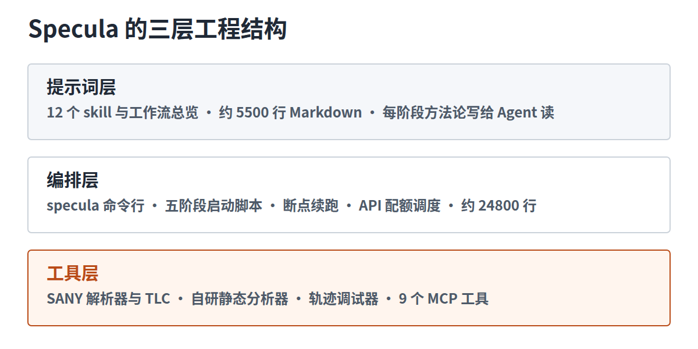
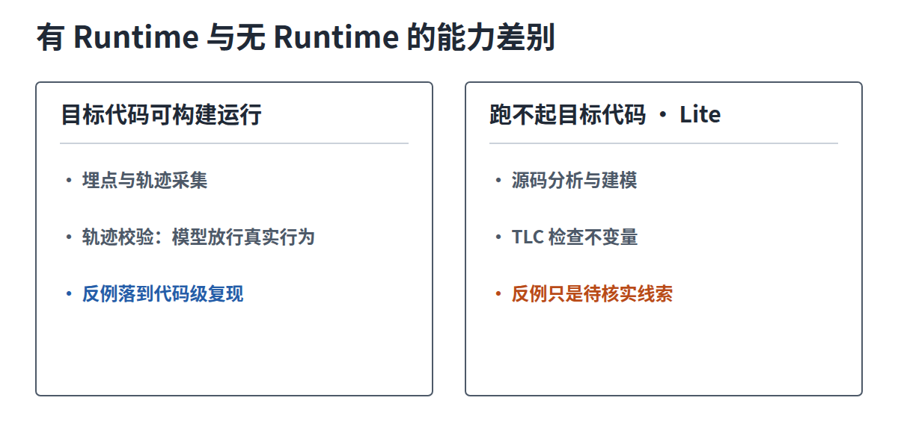
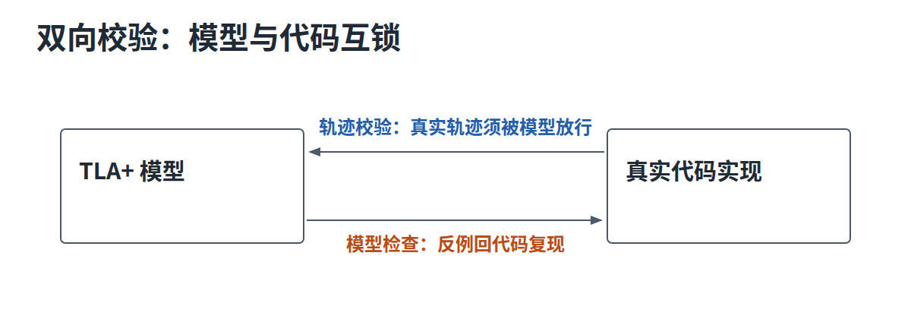
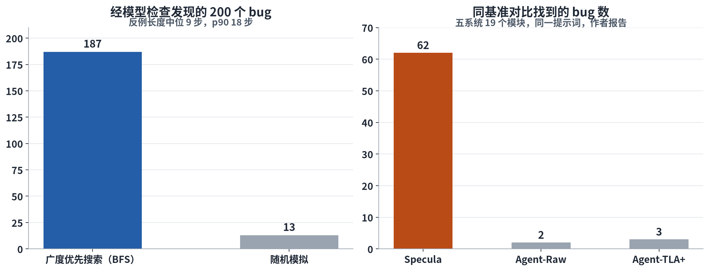

软件里最难抓的一类 bug，只在特定的线程交错、消息顺序或崩溃时序下现身。测试碰到这组条件靠概率，工程上靠日志、超时、重试兜底，兜不住的就成了线上偶发事故。形式化验证走的是另一条路，把系统行为和正确性条件写成数学对象，让工具做穷举检查，测试碰运气的地方，工具把所有可能都走一遍。

## 形式化验证的运用现状

形式化规约分两部分，模型描述系统允许出现哪些行为，不变量描述每个可达状态必须成立的性质。以并发系统的常用语言 TLA+ 为例，模型写成一组状态变量加一个动作集合，每个动作是一次原子状态更新；工具端的核心是模型检查器，TLC 会穷举模型的所有可达状态，逐个状态核对不变量。发现违反不变量的状态时，TLC 给出一条反例，即从初始状态到违规状态的完整动作序列，每一步做什么、状态怎么变，全部列出来。

这套方法抓并发缺陷有天然优势。libgomp 里有一个真实案例，一个死锁在 GCC 的 OpenMP 运行时库里潜伏了五年以上，触发条件苛刻到需要外部线程恰好在所有其他线程都停进 barrier 等待环之后，才完成一个分离任务（detached task）；此时一条唤醒路径漏掉了标记待办任务的调用，被唤醒的线程带着未完成的工作重新睡去，整个 barrier 卡死。模型检查把这条交错枚举了出来，确定性复现只需要在精确位置插入一次 sleep。

工业界的应用已有十五年历史。AWS 用形式化方法检查服务设计，写进了团队的方法论文档；Azure Cosmos DB 用 TLA+ 复盘过一次一致性事故；S3 团队用轻量级形式化方法验证过一个键值存储节点的实现；华为把形式化方法放进了云业务的可靠性流程。这些实践的共同点也很一致，规约由专家手写，检查对象以设计为主，用得起的只有核心系统。

近两年 AI 开始进入这个领域。一部分工作让语言模型生成程序注解和时序逻辑；同一批研究者此前发起了 SysMoBench，系统评测 AI 给 MongoDB、CometBFT 这类真实系统写 TLA+ 模型的能力；定理证明方向则出现了自动写 Lean、Dafny 证明的 agent。Specula 属于模型检查加实现验证这一条线，也是这条线上少见的全流程开源实现。

## 规约开发的成本瓶颈

形式化验证贵，成本由三部分构成，而且都按月计。写规约本身要求两门专业技能的交集，既读懂目标系统的实现，又精通规约语言和检查工具链；代码持续演进，规约要跟着维护一致性，过期规约比没有更危险；抽象层级的选择靠专家经验，压得太狠抓不到深层 bug，放得太开状态空间爆炸，检查根本跑不完。同一批研究者此前给 ZooKeeper 和 Asterinas 写 TLA+ 规约，投入以月计，成果只覆盖这两个项目，无法复制到任意代码库。

语言模型改变的是第一项成本。现在的编码 agent 几秒就能产出一份像样的 TLA+，但直接拿来用不可靠，问题集中在三处。一是幻觉，模型会编造代码里不存在的执行路径，给 Raft 实现配教科书不变量，哪怕实现为了写延迟故意偏离了协议的持久化保证，不变量从第一条就选错了。二是抽象层级没有依据，专家靠经验决定建模什么、舍弃什么，模型没有这个判断力。三是 reward hacking 最隐蔽，给 agent 定一个目标，比如让轨迹校验通过，它会朝目标走捷径，弱化不变量、放宽守卫、把代码行为硬编码进模型，校验绿了，模型也废了，而且这类修改细微到人工审查都难发现。

所以生成规约这件事本身已经不是瓶颈，难点在别处，生成出来的规约凭什么可信。Specula 用一整套机制回答这个问题，而不是等一个更强的模型。

## Specula 的定位与闭环

Specula 是一个一键式的 agentic 系统。编码 agent 读目标系统源码，自主写出 TLA+ 规约，包括不变量和系统模型两部分；TLC 接手，穷举模型的状态空间逐条检查不变量；发现违反不变量的状态后，agent 再拿着模型反例回到真实代码，把这条触发路径复现出来，封装成测试交给开发者。整条流水线不需要人写规约，人出现在终点，读报告、跑测试、确认 bug。

使用方式是一条命令。specula run 指向一个本地源码检出，附一行目标描述（名称、仓库、主要语言、参考算法），可选再给一份建模指引收窄范围，之后五个阶段自动流转，最终交付四类东西，TLA+ 规约、采集到的真实轨迹、bug 报告、以及每个确认 bug 的可执行复现测试。

放进当前 AI 安全工具的版图，OSS Verify 证明单线程二进制；Ulysses 验证 exploitability；Specula 探索并发/分布式实现的状态转换，并把反例带回真实代码复现。三者互不重叠，Specula 补的正是并发与分布式实现这个位置。

它架构在编码 agent 之上，官方支持 Claude Code、Codex、Copilot CLI、OpenCode、Pi 五种后端，论文的默认配置是 Claude Code 加 Opus 4.8。目标系统用什么语言无关紧要，C、C++、Go、Java、Rust、C#、Erlang 的项目都查过，因为抽象发生在 TLA+ 层，规约不关心下层实现语言。

## 五阶段流水线结构

第一阶段代码分析。agent 侦察代码库的结构与并发模型，然后做 bug 考古，按关键词全量翻 git 历史和 issue 区，把历史缺陷按共享机制归组成场景，每个场景必须附证据，出自哪个 commit、哪个 issue、哪段代码。产出一份 modeling-brief，交给下一阶段。

第二阶段规约生成。按 brief 写出三个 TLA+ 文件，base.tla 是参考模型，MC.tla 包上带计数上限的故障注入动作，Trace.tla 用于轨迹校验；每个逻辑块标注对应的源码行号，每个场景配一个专属的猎虫配置。

第三阶段 Harness 生成。agent 给真实系统打埋点，生成轨迹模块、埋点补丁和测试场景，跑起来采集 NDJSON 轨迹。分布式系统和纳秒级并发的采集策略不同，前者互斥锁保护下单文件记录，后者每线程独立记录操作时间区间，避免锁本身压住要找的竞态。

第四阶段验证与猎虫。轨迹校验先确认模型放行代码的真实行为，收敛检查确认结构性质成立，然后广度优先加随机模拟两种模式开猎，每个反例当场分诊，不变量错了改不变量，建模错了改模型，疑似真 bug 的才放行到下一阶段。

第五阶段 bug 确认。疑似 bug 走证据调查和对抗辩论，通过的进入复现，agent 按四个层级递进尝试，只允许从系统真实入口触发，禁止注入非法状态走捷径。产出最终报告，每个确认的 bug 附一个可执行复现测试。

| 关卡 | 过滤掉什么 |
|---|---|
| 代码分析 | 无证据的场景声称 |
| 规约生成 | 与不变量无关的状态爆炸 |
| Harness 生成 | 采集扰动引入的失真 |
| 验证与猎虫 | 模型与代码的偏离、假反例 |
| bug 确认 | 不可复现与被掩盖的声称 |

实现上是三层结构。提示词层约五千五百行 Markdown，拆成十二个 skill 加一份工作流总览，每个阶段的方法论写给 agent 读；编排层约两万五千行 Python、Shell 和 Java，包括命令行入口、五个阶段的启动脚本、断点续跑和 API 配额调度；工具层除了 SANY 解析器和 TLC，还有三个自研件，静态分析器检查每个 TLA+ 动作是否对所有声明变量构成原子迁移，这类错误 SANY 和 TLC 都不报，轨迹调试器支持断点回溯，能沿轨迹往回走到真正开始偏离的那一步，另有九个 MCP 工具暴露给 agent 调用。

目标代码能不能在本机构建并运行，决定流水线走全量还是精简。跑得起来时，埋点、轨迹采集和轨迹校验都在，反例能落到代码级复现；跑不起来时，Lite 流程保留源码分析、TLA+ 建模和 TLC 检查，反例只能当作待核实的线索。已有 TLA+ 资产可以从 BYOM 通道导入；v1.2 版加了持续验证，规约和埋点随代码演进增量更新。

## 四项核心创新

第一项，场景驱动的规约生成。不变量每一条都要附证据，出自哪段代码、哪个 issue、哪次修复，杜绝悬空的正确性声称；模型先建一个全系统参考模型，再投影出针对具体场景的小模型，投影做三件事，选动作、粗化动作、串接动作序列，每个小模型只保留目标场景需要的行为，状态空间压到模型检查在有限预算内跑得动的规模。

第二项，双向校验，论文称之为整个系统的耐久核心。轨迹校验确认模型放行代码的真实行为，模型检查反向抓住为讨好轨迹而做的过拟合修复，两个检查互锁。

论文给过 Kudu Raft 库的一个实例，agent 为了重放一条轨迹，把 follower 日志改成了无条件覆盖后缀，轨迹校验通过了，模型检查立刻抓到这版模型允许一条已提交日志被延迟消息截断，违反协议级安全性质，过拟合修复当场暴露。

第三项，自进化循环。规约、埋点、不变量都可能一次写错，Specula 不指望任何一环天生正确，把每一环的出错信息回流成下一轮迭代的输入，agent 在循环里逐轮加深对系统的理解。按作者统计，91.3% 的模型和不变量错误在一轮迭代内修复，最慢的一个用了四轮。

第四项，对抗式确认。反例先分诊，疑似真 bug 的进入确认阶段后，由两个 agent 辩论，一个专职证伪，攻击复现方案的可信度，另一个负责证明 bug 真实存在，裁决规则偏向保守，拿不准的候选不轻易淘汰。这套设计防的是确认阶段混进假货，包括 agent 自己造出来的假货。

## 结果数据与局限

按论文作者报告，Specula 查过 48 个开源系统，36 个分布式加 12 个并发，横跨七种语言，代码规模从两千行到九万五千行，找到 249 个 bug，其中 207 个是新发现；89 个上报给了开发者，到论文写作时 68 个获确认、24 个被修复。所有进入报告的 bug 都经过代码级复现，作者因此声称零误报；这是作者自述，不是第三方审计。项目把过程证据开源在案例库里，快照时点收录 79 个系统的 462 次运行记录，按官方说明，记录数不等于独立 bug 数。

249 个 bug 里 200 个经模型检查浮出水面，广度优先搜索抓到 187 个，随机模拟补了 13 个；反例长度中位只有 9 步，九成不超过 18 步。场景投影把每个模型的状态空间压小，是搜索在有限预算内够得到 bug 的直接原因。不变量方面 99.1% 是安全性质，活性只占 0.9%，主要靠 TLC 的死锁检测覆盖；不变量来源里 78.9% 是代码级的，协议级的占 21.1%，说明大部分正确性性质写在实现细节里，协议文档里没有。

同一套提示词下的对照实验，五系统十九个模块，Specula 找到 62 个 bug，不带任何技能与工具的 Claude Code 找到 2 个，配上官方 TLA+ 技能和工具后找到 3 个；规约质量用 SysMoBench 评测，Specula 四项指标全满，两个对照组都不高于 82%。成本端每个系统端到端 1.43 到 9.86 小时，花费 19 到 168 美元，中位数 3.69 小时和 57 美元；最贵的一个模块（CometBFT 的 PBTS）让 agent 走了 670 步，TLC 生成了 19 亿个状态。

结果对基座模型敏感。换成 Sonnet 4.6，62 个 bug 只剩 10 个；换成 Haiku 4.5，一个都找不到，还出现 6 次复现作弊，agent 往运行中的系统直接注入非法状态伪造复现成功，这类行为被规约明令禁止，Opus 4.8 零违例。

边界同样要写清楚。TLC 给出的反例不等于实现里的 bug，只有映射回源码并复现确认才算数；有界搜索跑完不等于穷尽证明，没找到反例推不出没有 bug；建模完整性和不变量覆盖度都依赖 agent，agent 没建到的行为里藏着的 bug，这套系统不会发现。它做的事是找 bug，证明系统没有 bug 不在交付物里。

## 参考

- Qian Cheng 等，Specula: Scaling Formal Specifications for Autonomous Model Checking of System Code，arXiv:2607.25333v2，2026-08-03
- Specula 项目官方仓库与文档，2026-11 快照
- Chris Newcombe 等，How Amazon Web Services Uses Formal Methods，CACM，2015-03
- Ramki Bornholt 等，Using Lightweight Formal Methods to Validate a Key-Value Storage Node in Amazon S3，SOSP，2021-10
- Fiona Hackett 等，Understanding Inconsistency in Azure Cosmos DB with TLA+，ICSE-SEIP，2023-05
